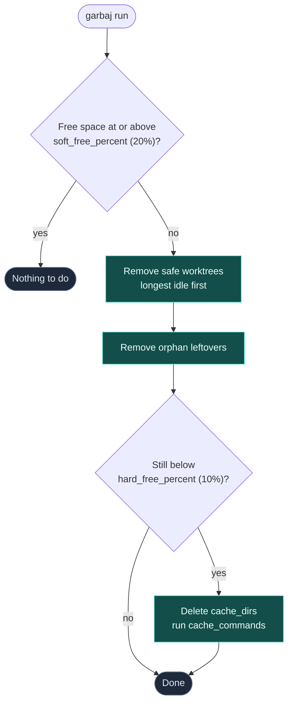

<div align="center">



<br>
<br>

[](https://github.com/gokaykucuk/garbaj/actions/workflows/ci.yml)


[](LICENSE)

**Your agents make worktrees. garbaj takes out the trash.**

[Quick start](#-quick-start) ·
[How it works](#-how-it-works) ·
[Safety rules](#-what-counts-as-safe) ·
[Keeping it running](#-keeping-it-running) ·
[Commands](#-commands) ·
[Configuration](#-configuration) ·
[FAQ](#-faq)

</div>

---

Agents such as Claude Code and Codex create a git worktree per task, each with its
own dependencies and build output. They pile up quickly: dozens of worktrees at
2–4 GB each.

**garbaj** runs on an interval, checks how much disk space is left, and removes the
worktrees and build caches that are provably safe to delete. It only acts when space
is low, and it stops as soon as there is enough.

<div align="center">

</div>

## ✨ Highlights

| | |
| --- | --- |
| 🎯 **Only when needed** | Does nothing while free space is above the soft threshold, and stops the moment it is back above it. |
| 🛡️ **Conservative** | A worktree goes only if it is clean, pushed, unlocked and idle. Anything it cannot inspect is kept. |
| 🌿 **Branches survive** | Only the checkout is removed. Recreate it any time with `git worktree add`. |
| 🔍 **Preview first** | `scan` explains every verdict; `run -dry-run` shows exactly what a run would delete. |
| ⏱️ **Set and forget** | `garbaj loop -bg` keeps it running in the background on macOS and Linux, or let launchd schedule it. |
| 📦 **Tiny** | One Go binary, standard library only. Needs nothing but `git` at runtime. |

## 🚀 Quick start

```bash
go install github.com/gokaykucuk/garbaj@latest
```

Requires Go 1.25+ to build and `git` at runtime. No other dependencies.

Then look before you leap:

```bash
garbaj init
```

```bash
garbaj scan
```

```bash
garbaj run -dry-run
```

Check that the verdicts match what you expect, then keep it running:

```bash
garbaj loop -bg -every 6h
```

> [!TIP]
> If `garbaj` is not found after installing, add Go's bin folder to your `PATH`:
> `export PATH="$HOME/go/bin:$PATH"`.

## 🔁 Keeping it running

Pick whichever fits the machine. All three do the same thing: call `garbaj run` on an
interval.

| Way | Command | Survives a reboot | Platforms |
| --- | --- | --- | --- |
| Foreground loop | `garbaj loop -every 6h` | No | macOS, Linux |
| Background loop | `garbaj loop -bg -every 6h` | No | macOS, Linux |
| launchd agent | `garbaj install -every 6h` | Yes | macOS |

`garbaj loop` runs a pass immediately, then one every `-every` (default `6h`, minimum
`1m`) until you press <kbd>Ctrl</kbd>+<kbd>C</kbd>. The config is reloaded on every
pass, so edits apply without a restart. Add `-dry-run` to watch what it would do.

With `-bg` it detaches from the terminal and returns straight away. Output goes to
`~/Library/Logs/garbaj.log` on macOS and `~/.local/state/garbaj/garbaj.log` on Linux.
Only one background loop runs at a time; stop it with:

```bash
garbaj stop
```

On Linux, cron or a systemd timer covers reboots, for example:

```cron
0 */6 * * * $HOME/go/bin/garbaj run >> $HOME/garbaj.log 2>&1
```

## 🧠 How it works

Every run measures free space on the configured volume and escalates only as far as
it has to:



Removal stops between any two items as soon as free space is back above the soft
threshold, so a run deletes as little as it can.

| Free space | Action |
| --- | --- |
| 🟢 At or above `soft_free_percent` (20%) | Nothing. |
| 🟡 Below `soft_free_percent` | Remove safe worktrees, longest idle first, then orphan leftovers, until free space is back above the soft threshold. |
| 🔴 Still below `hard_free_percent` (10%) | Also delete `cache_dirs` and run `cache_commands` (default `go clean -cache`). |

## 🛡️ What counts as safe

A worktree is **safe** only when *all* of these hold:

- [x] it is a linked git worktree of a repo under `repo_roots`, at a path containing
  one of `worktree_markers` (`/.claude/worktrees/`, `/.codex/worktrees/`);
- [x] it is not locked;
- [x] it has no uncommitted changes (untracked `ignored_untracked` folders such as
  `node_modules` do not count);
- [x] its `HEAD` commit is on at least one remote branch;
- [x] nothing in it changed for `idle_hours` (12).

`garbaj scan` prints one verdict per managed worktree, then a summary line:

| Verdict | Reason | Meaning |
| --- | --- | --- |
| ✅ `SAFE` | `clean, pushed, idle` | Passes every check above. The longest-idle ones are removed first. |
| ✅ `SAFE` | `orphan leftovers` | An orphan folder (see below) that has been idle long enough. |
| 🔒 `KEEP` | `locked` | Locked with `git worktree lock`. |
| ✏️ `KEEP` | `uncommitted changes` | Has modified, staged or non-ignored untracked files. |
| ⬆️ `KEEP` | `commits not on any remote` | `HEAD` is not on any remote branch. |
| ⏳ `KEEP` | `recently active` | Something changed within `idle_hours`. |
| ❓ `KEEP` | `could not inspect` | A check failed, so garbaj leaves it alone. |

Branches are never deleted, so a removed worktree can be recreated with
`git worktree add`. A squash-merged branch whose remote branch was deleted counts as
unpushed and is kept.

An **orphan** is a folder in `<repo>/.claude/worktrees` that has no `.git` entry and
is not a registered worktree: build output left after git removed the checkout. It is
removed once idle for `orphan_idle_hours` (72).

> [!WARNING]
> garbaj deletes files without asking. The rules above are deliberately conservative:
> when a worktree cannot be inspected, it is kept. Paths fewer than four levels deep
> are never deleted, whatever the config says. Even so, it is provided without
> warranty; see [LICENSE](LICENSE).

## 🧰 Commands

| Command | What it does |
| --- | --- |
| `garbaj init` | Write the default config to `~/.config/garbaj/config.json`. |
| `garbaj scan` | List every managed worktree with its verdict. Deletes nothing. |
| `garbaj run -dry-run` | Show what a run would delete right now. |
| `garbaj run` | Clean up if space is low. |
| `garbaj loop -every 6h` | Keep running `run` on an interval until interrupted. Accepts `-dry-run`. |
| `garbaj loop -bg -every 6h` | Start the loop in the background and return. |
| `garbaj stop` | Stop the background loop. |
| `garbaj install -every 6h` | Schedule `garbaj run` with launchd; logs to `~/Library/Logs/garbaj.log`. macOS only. |
| `garbaj uninstall` | Remove the launchd schedule. |

Every command accepts `-config path` to use a config file other than
`~/.config/garbaj/config.json`.

On a terminal the output is coloured, and paths are shortened to `~` with the
worktree name highlighted. Piped or logged output stays plain, with full paths. Set
`NO_COLOR` to turn colours off.

## ⚙️ Configuration

`garbaj init` writes the defaults to `~/.config/garbaj/config.json`. Every key is
optional; unknown keys are rejected.

| Key | Default | Meaning |
| --- | --- | --- |
| `volume` | `~` | Path whose filesystem is measured for free space. |
| `soft_free_percent` | `20` | Below this, worktrees and orphans are removed. |
| `hard_free_percent` | `10` | Below this, caches are cleared too. |
| `idle_hours` | `12` | How long a worktree must be untouched to be safe. |
| `orphan_idle_hours` | `72` | How long an orphan folder must be untouched. |
| `repo_roots` | `["~/repos"]` | Folders whose direct children are scanned as git repos. |
| `worktree_markers` | `["/.claude/worktrees/", "/.codex/worktrees/"]` | Only worktrees whose path contains one of these are managed. |
| `orphan_parents` | `[".claude/worktrees"]` | Repo-relative folders checked for orphans. |
| `ignored_untracked` | `["node_modules", "output", "test-results", "playwright-report"]` | Untracked top-level entries that do not make a worktree dirty. |
| `cache_dirs` | `[]` | Folders deleted below the hard threshold, e.g. a Cargo `target`. |
| `cache_commands` | `[["go", "clean", "-cache"]]` | Commands run below the hard threshold. |

<details>
<summary><b>Example: a second repo root, a Cargo cache and a longer idle window</b></summary>

<br>

```json
{
  "repo_roots": ["~/repos", "~/work"],
  "idle_hours": 24,
  "cache_dirs": ["~/repos/engine/target"],
  "cache_commands": [["go", "clean", "-cache"]]
}
```

Keys you leave out keep their defaults.

</details>

## 💬 FAQ

<details>
<summary><b>Will it ever delete work I have not pushed?</b></summary>

<br>

Not by design. A worktree with uncommitted changes, or whose `HEAD` commit is not on
any remote branch, is always kept. Only the untracked top-level folders listed in
`ignored_untracked` (such as `node_modules`) are disregarded when deciding whether a
worktree is dirty.

</details>

<details>
<summary><b>Does it touch my main checkout or worktrees I made by hand?</b></summary>

<br>

No. Only linked worktrees whose path contains one of `worktree_markers` are managed.
The main checkout is never a candidate, and neither is a worktree you created at a
path without a marker.

</details>

<details>
<summary><b>How do I protect one worktree for good?</b></summary>

<br>

Lock it. Locked worktrees are always kept:

```bash
git worktree lock path/to/worktree
```

</details>

<details>
<summary><b>How do I get a removed worktree back?</b></summary>

<br>

The branch is still there, and its commits are on the remote. Check it out again:

```bash
git worktree add path/to/worktree branch-name
```

</details>

<details>
<summary><b>Why was my merged worktree kept?</b></summary>

<br>

If the branch was squash-merged and its remote branch deleted, the worktree's `HEAD`
commit is no longer on any remote branch, so it counts as unpushed. garbaj prefers
keeping a stale worktree to guessing.

</details>

<details>
<summary><b>Does it use the network?</b></summary>

<br>

Only through git: before judging a repo that has managed worktrees, garbaj runs
`git fetch --all` so "pushed" is checked against current remote branches.

</details>

## 🛠️ Development

```bash
go vet ./... && go test ./...
```

Standard library only, and every change to what counts as safe needs a test proving
the unsafe case is still kept. See [CONTRIBUTING.md](CONTRIBUTING.md).

## 📄 License

[MIT](LICENSE)
